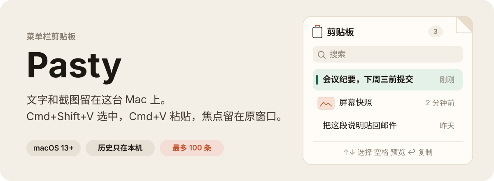
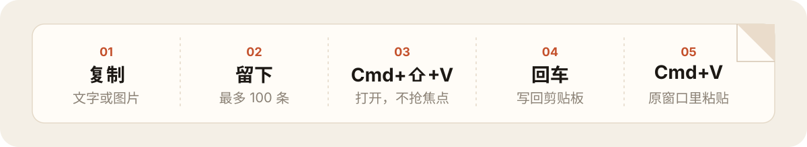

# Pasty

<p align="center">
  
</p>

> 写东西、截图时复制过的文字和图片，留在这台 Mac 的菜单栏里。按 Command+Shift+V 选中一条，再按 Command+V，它就贴回当前窗口。

## 你能得到什么

| 场景 | 操作 | 结果 |
| --- | --- | --- |
| 刚才复制的文字还要再贴一次 | Command+Shift+V，左右选择，回车 | 贴回正在用的窗口，焦点不离开 |
| 连着截了几张图 | 在横排卡片里点中那一张 | 选中的图写回系统剪贴板 |
| 有几条会反复用到 | 点卡片上的钉子，或按 Command+P；再按 Command+2 | 这些卡片留在对应的固定点里，不会被 100 条上限挤掉 |
| 固定的东西要分成几组 | 点「+」新建固定点，再点铅笔改名称 | 每一组有自己的名字，Command+2、Command+3 分别打开 |
| 不想按方向键 | 在卡片上滚动鼠标滚轮 | 向上相当于 ←，向下相当于 → |

## 它怎样工作

<p align="center">
  
</p>

Pasty 在后台看系统剪贴板。有新的文字或图片，就记到本机历史里。按 Command+Shift+V 打开一排横着的卡片，面板不抢走当前窗口的焦点。滚轮上下和左右方向键一样，用来换当前选中的卡片。点钉子可以把卡片放进一个固定点。固定点可以有多个，名称可以改。之后用 Command+2、Command+3，或菜单栏里的固定点名称调出来。未固定的历史最多 100 条。系统截图若存成文件，新的一张也会进来。

## 安装与第一次使用

### Windows（便携 EXE）

1. 打开 [pasty.coderfather.com](https://pasty.coderfather.com)，或直接下载 [Pasty-1.3.0-windows-x64.exe](https://github.com/zack6116/Pasty/releases/download/v1.3.0/Pasty-1.3.0-windows-x64.exe)。
2. 双击运行。成功标志：系统托盘出现 Pasty 图标。
3. 复制一段文字，按 **Ctrl+Shift+V**，卡片里能看到刚才的内容。选中后按 **Ctrl+V** 贴回原来的窗口。

### macOS

需要 macOS 13 或更高版本，以及 Apple 芯片。下载包不包含 Intel 版；Intel Mac 请在本机从源码构建。

1. 下载 [Pasty-1.3.0-macos-arm64.dmg](https://github.com/zack6116/Pasty/releases/download/v1.3.0/Pasty-1.3.0-macos-arm64.dmg)，打开。
2. 把 `Pasty.app` 拖进「应用程序」文件夹。
3. 这个包没有 Apple 公证。下载后 macOS 会拦住，先去掉隔离标记再打开：

```bash
xattr -dr com.apple.quarantine /Applications/Pasty.app
open /Applications/Pasty.app
```

4. 成功标志：菜单栏出现剪贴板图标。复制一段文字，按 **Command+Shift+V**，卡片里能看到刚才的内容。选中它，再按 **Command+V**，它贴回原来的窗口。

打开之后：

- **Command+Shift+V**：打开或关闭历史
- **← / →**：选择一张卡片。↑ / ↓ 同样可以移动
- **滚轮向上 / 向下**：和 ← / → 一样，换当前选中的卡片
- **空格**：放大预览，再按一次关闭
- **Return** 或点击卡片：把选中项写回剪贴板并关闭
- **Command+P**，或点卡片上的钉子：固定到当前固定点，或取消固定。有多个固定点时，从未固定的卡片上选一个放进去
- **+**：新建固定点。选中后点铅笔，可以改这个固定点的名称
- **Command+2**、**Command+3**……：按顺序打开固定点。Command+1 回到最近。菜单栏里也能按名称打开
- **右键**：固定到某个固定点，或删除这一条
- **Esc**：关闭预览；没有预览时关闭面板
- 在搜索框里输入，可以按文字过滤

Pasty 运行时会占用 Command+Shift+V。其他应用里的「粘贴并匹配格式」收不到这个快捷键。

## 权限、数据与隐私

剪贴板历史不离开这台 Mac。启动时会向运营看板上报一次安装设备，用来统计安装次数。

| 它碰到的数据 | 去向 |
| --- | --- |
| 系统剪贴板里的文字和图片 | 写入 `~/Library/Application Support/Pasty/`，只在这台 Mac 上 |
| 截图目录里新保存的图片 | 读进同一份本地历史。目录来自系统截图设置，没改过就是桌面 |
| 空白内容，以及标成隐藏、临时或自动生成的剪贴板 | 不入库 |
| 安装编号、应用版本、macOS 版本、机型、芯片架构、语言 | 每次启动发到 [ops.coderfather.com](https://ops.coderfather.com/v1/report)，产品名是 `pasty`。同一个安装编号只算一次安装。不包含剪贴板、用户名或序列号 |

它不申请辅助功能权限。Command+Shift+V 用系统热键注册。截图若在桌面或文稿，macOS 可能会询问是否允许读取该文件夹。「登录时打开」若需要批准，到「系统设置 › 通用 › 登录项与扩展」里允许 Pasty。

## 使用边界

- Windows：下载 EXE 即可用，无需安装。历史在 `%LOCALAPPDATA%\Pasty\`。
- macOS：需要 13 及以上。GitHub Release 里的 Mac 包只含 Apple 芯片；ad-hoc 签名、未公证，下载后要先去掉隔离标记。
- 未固定的历史最多 100 条，更早的会被删掉。放进固定点的卡片会留下来，直到移出或删除。固定点最多 12 个，名称最长 16 个字。历史不跨设备同步。
- 安装统计需要能访问 `ops.coderfather.com`。连不上时剪贴板功能照常使用，这次上报会丢掉。
- 密码管理器如果没有把剪贴板标成隐藏，那段内容仍可能被记下。
- 「登录时打开」要先把 `Pasty.app` 放进「应用程序」文件夹。
- 菜单栏里可以清空全部历史。

## 从源码构建

需要 Swift 命令行工具。

```bash
./scripts/build-app.sh
open Pasty.app
```

脚本会编译 release 版本，打成 `Pasty.app`，并用 ad-hoc 签名。`Pasty.app` 不会提交到仓库。在本机刚构建的应用没有下载隔离标记，一般可以直接打开。

没有完整 Xcode 时，不能用 `swift test`。测试是一个可执行目标：

```bash
swift run PastyTests
```

## 贡献与反馈

问题用 [GitHub Issues](https://github.com/zack6116/Pasty/issues)。不要在 Issue 里粘贴剪贴板原文或带私人内容的截图；先描述发生了什么。

也可以在 [X](https://x.com/zack6116) 找到维护者。

## License

[MIT](LICENSE)
